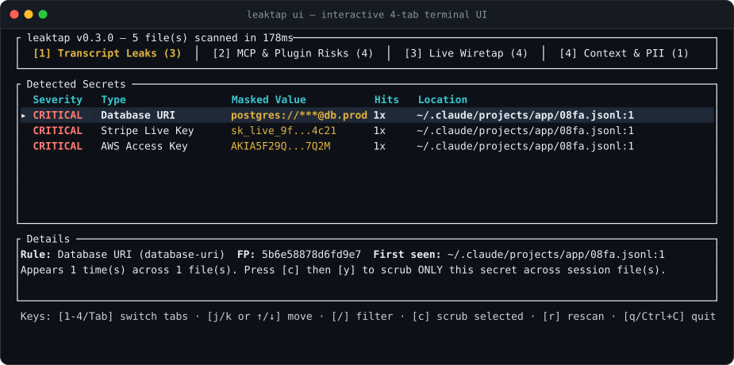

# leaktap

[](https://github.com/vssinghh/leaktap/actions/workflows/ci.yml)
[](LICENSE)

`leaktap` scans local AI coding CLI logs, SQLite databases, MCP configs, and installed plugins for leaked secrets and risky shell hooks. It can also scrub old logs in place and wrap live CLI sessions to inspect, block, or redact outgoing API requests.

Live session wrapping works with **Claude Code** (`claude`), **Codex CLI** (`codex`), **Antigravity CLI** (`agy`), **Gemini CLI** (`gemini`), and local MCP servers (plus OpenRouter, DeepSeek, xAI, and Groq API endpoints). Offline `scan` also checks local state, MCP configs, and rule files left by Cursor, Windsurf, Cline, Roo Code, Zed, JetBrains Junie, Amazon Q, Kiro, Augment, Trae, Continue, and Aider.

> **2026 Top 20 MCP Audit ([full write-up & dataset](docs/mcp-top-20-audit.md)):** We ran `leaktap scan` and `leaktap tap` across the 20 most-starred standalone MCP servers on GitHub (`629,809` stars combined). **25% (`5 / 20`)** made non-API outbound HTTPS calls on startup (telemetry, update checks, or a `140` to `190 MB` browser download) before any tool ran, **35% (`7 / 20`)** ship default-on telemetry in source or live traffic (**2** without root `README` notice), **35% (`7 / 20`)** guide users to put raw API keys in JSON configs or CLI flags, and **90% (`18 / 20`)** use unpinned installs (**5** mutable `:latest` tags or GitHub branches, **13** unpinned `npx`/`uvx` quickstarts).



## Install

Build from a tagged release with `cargo`:

```bash
cargo install --git https://github.com/vssinghh/leaktap --tag v0.4.2 --locked
```

Download a prebuilt binary on macOS or Linux (read the script before running it):

```bash
curl -fsSLO https://raw.githubusercontent.com/vssinghh/leaktap/v0.4.2/install.sh
less install.sh
LEAKTAP_VERSION=v0.4.2 sh install.sh

# Optional: verify GitHub Actions build attestation
gh attestation verify ~/.local/bin/leaktap --repo vssinghh/leaktap
```

Prebuilt binaries, `.sha256` checksums, and build attestations for macOS, Linux, and Windows are on [GitHub Releases](https://github.com/vssinghh/leaktap/releases).

## The Problem

1. **Debugging leaves plain-text secrets on disk and in prompts.** When `claude`, `codex`, `cursor`, `gemini`, or `agy` debugs a project, it reads `.env` files, cloud credentials, private keys, and config files. Those values get sent in API prompts and saved in plain text inside local chat logs and SQLite databases (`~/.claude`, `~/.codex`, `~/.cursor`, `~/.gemini`), where they stay long after the session ends.
2. **MCP servers, plugins, and repo configs run with your user permissions.** MCP (Model Context Protocol) tool servers and plugins start as local child processes with access to your environment variables, files, and internet connection. A cloned repo or third-party server can also trigger shell hooks (`.claude/settings.json`, `hooks.json`, IDE tasks), pull unpinned `npx` or `uvx` code on startup, send default-on telemetry, or hide prompt-override instructions inside `CLAUDE.md`, `SKILL.md`, or tool descriptions.
3. **Standard tools leave a gap:**
   - Git secret scanners (`gitleaks`, `trufflehog`) check repo commits, not `~/.claude` logs, SQLite `-wal` files, or MCP configs.
   - File sandboxes (`bubblewrap`, `sandbox-exec`) can block `~/.ssh`, but the CLI still needs to read your workspace `.env` and reach its API over the internet.
   - HTTPS inspection proxies (`mitmproxy`) can read traffic, but require installing a custom root TLS certificate that trusts a local key for all HTTPS connections.

`leaktap` fills that gap as a single Rust binary with no root certificates or `sudo`. Offline, it scans local AI logs, SQLite databases, MCP configs, and plugins in ~150ms and scrubs leaked keys in place. Live, it wraps CLI or MCP sessions to strip unrelated shell secrets, check outgoing API requests over `localhost`, and log outbound network connections.

## Usage

### Scan logs, databases, MCP configs, and plugins

Runs offline by default. Checks `~/.claude`, `~/.codex`, `~/.gemini`, `~/.cursor`, `~/.codeium/windsurf`, `~/.continue`, installed plugins and skills, hooks, IDE tasks, and workspace MCP or rule files.

It catches API keys, private keys (PEM, OpenPGP, JWK, GCP service accounts, Kubernetes `Secret` files), database URLs, and passwords, even when encoded in Base64, `gzip`+Base64, hex dumps, UTF-16, Unicode/URL escapes, or SQLite `-wal` files. For plugins and MCP scripts, it also follows local helper imports (up to 2 files deep) to spot split exfiltration scripts.

```bash
# Default local audit (exits 0; add --ci to fail builds on HIGH/CRITICAL findings)
leaktap

# Scan both the current repo and global ~/.claude, ~/.codex, ~/.cursor, and ~/.gemini folders
leaktap scan --all --ci

# Opt-in: run read-only API checks across 24 providers to see which leaked keys are still active
leaktap scan --verify --fail-on critical

# Opt-in: query live MCP servers for poisoned tool descriptions and save hashes in a lockfile
leaktap --mcp-pins-file ./mcp-pins.lock scan --inspect-mcp --ci

# Refresh saved MCP tool hashes after upgrading a server
leaktap --mcp-pins-file ./mcp-pins.lock scan --inspect-mcp --update-mcp-pins

# Scan a specific repo, skill folder, or single file
leaktap scan ./my-project --ci
leaktap scan ./third-party-skill --ci

# Pre-commit check on staged git files
leaktap scan --staged --ci

# Scan git commit history across all branches
leaktap scan --git-history --fail-on critical
leaktap scan --git-history --max-commits 1000 --ci

# Pull-request CI check using the policy from origin/main with SARIF output
LEAKTAP_FINGERPRINT_SALT="$SARIF_SALT" leaktap scan . --policy-git-ref origin/main --format sarif --ci > leaktap.sarif
```

`--inspect-mcp` blocks connections to loopback, private, and cloud-metadata IPs and does not expand `${ENV}` variables from untrusted repo configs.

### Watch, block, or redact live CLI sessions

Start `claude`, `codex`, `agy`, or `gemini` through `leaktap`. Extra flags pass straight to the CLI:

```bash
# Watch outgoing prompts, scrub extra shell secrets, and log child sockets
leaktap claude
leaktap codex
leaktap agy

# Also strip SSH_AUTH_SOCK from the CLI and its MCP servers
leaktap --scrub-ssh-agent claude

# Keep specific env vars needed by a tool or MCP server
leaktap --allow-env GH_TOKEN,GOOGLE_APPLICATION_CREDENTIALS claude

# Reject outgoing API requests (HTTP 400) containing secrets or critical prompt injections
leaktap --block-secrets claude

# Replace secrets with [REDACTED_BY_LEAKTAP] in transit (returns HTTP 400 if a secret cannot be cleanly removed)
leaktap --redact-secrets claude
```

When wrapping a session, `leaktap`:

- Strips unrelated shell secrets (`AWS_SECRET_ACCESS_KEY`, `STRIPE_SECRET_KEY`, `DATABASE_URL`, `GOOGLE_APPLICATION_CREDENTIALS`, `DOCKER_CONFIG`, etc.) while keeping profile selectors (`AWS_PROFILE`, `KUBECONFIG`), the CLI's own API key, TLS CA paths, and anything in `--allow-env`.
- Routes supported `*_BASE_URL` env vars through a local HTTP port, decodes `zstd`/`br`/`gzip`/`deflate` bodies in memory, checks headers, prompts, and MCP tool results, and forwards the request upstream over HTTPS. WebSocket upgrades get `HTTP 426` so clients fall back to HTTP/SSE. With `--block-secrets`, `leaktap` refuses to start if a repo config overrides `*_BASE_URL`.
- Checks non-TTY MCP `tools/list` and `tools/call` traffic for tool poisoning or unexpected schema changes, records outbound `HTTP CONNECT` proxy hostnames (`http-connect` and `mcp-live-telemetry`) without custom TLS certificates, and logs child TCP/UDP sockets to `~/.leaktap/live.jsonl` (`0600`, rotated at `10 MiB`).

To wrap a single MCP server inside `.mcp.json`:

```bash
leaktap tap --scrub-env --scrub-ssh-agent --quiet --log ~/.leaktap/mcp.jsonl -- npx @org/some-mcp@1.2.0
```

### Clean old logs and SQLite databases

Runs a dry run by default. On a folder, `clean` only modifies AI session logs and skips repo code, scripts, and `.leaktap.bak` backups unless you pass `--include-code` or target one file directly.

With `--apply`, it rewrites UTF-8 and UTF-16 logs, cleans prompt history in `~/.claude.json` without touching login accounts or `mcpServers`, and scrubs SQLite and `-wal` databases (checking for active locks first so open IDEs are not corrupted, using a built-in Rust cleaner if `python3` is missing, and exiting `1` if locked secrets remain).

```bash
# Preview changes without editing files
leaktap clean

# Scrub leaked secrets in place
leaktap clean --apply

# Clean a specific file, or include repo source files
leaktap clean ./leaked.env --apply
leaktap clean ./my-repo --include-code --apply

# Keep a 0600 <file>.leaktap.bak copy before editing
leaktap clean --apply --backup
```

### Terminal UI

```bash
leaktap ui
```

Opens a 4-tab view (`Transcript Leaks`, `MCP / Plugin Risks`, `Live Wiretap`, and `Context & PII`). Press `/` to filter, `c` then `y` to scrub just the selected secret across session logs and SQLite databases (pass `--include-code` to include repo files), or `q` / `Ctrl+C` to exit.



### Policy files and allowlists (`.leaktap.toml`)

`leaktap` loads `~/.config/leaktap/config.toml` automatically. In CI, pass `--config path/to/policy.toml` or `--policy-git-ref origin/main` to load policy from a trusted base branch instead of a PR branch.

For test keys in source or config files, add `# leaktap:ignore` on the same line (or `// leaktap:ignore[rule-id]`, `/* leaktap:ignore */`, `<!-- leaktap:ignore -->`, or `# leaktap:ignore-next-line` above it). These comments are turned off under `--policy-git-ref` and `--no-inline-ignore`, do not apply to chat logs, backups, SQLite files, or AI state folders (`.claude/`, `.codex/`, `.gemini/`, `.cursor/`), and never silence MCP, plugin, or hook alerts.

```toml
# Optional secret salt for `[fp:...]` IDs and SARIF fingerprints
# (prefer setting LEAKTAP_FINGERPRINT_SALT in CI secrets rather than committing it):
# fingerprint_salt = "org-random-secret-salt"

[allowlist]
paths = ["tests/fixtures/**"]
rules = ["internal-hostname"]
stopwords = ["acme-sandbox-dummy"]
# Copy any 16-char `[fp:...]` ID from terminal, TUI, JSON, or SARIF output:
fingerprints = ["9f86d081884c7d65"]

[allowlist.rule_paths]
# Allow a specific rule on specific files without hiding leaked keys in those files:
mcp-unpinned-package = ["docs/examples/**"]

[[rules]]
id = "acme-prod-token"
name = "Acme Internal Prod Token"
description = "Internal Acme production service token (acme_live_...)."
severity = "critical"
category = "secret"
anchors = ["acme_live_"]
pattern = 'acme_live_[A-Za-z0-9]{24,64}'
min_entropy = 3.2
```

### List detection rules

```bash
leaktap rules
leaktap rules --format json
```

## Limitations

- `leaktap` runs in user space without `sudo`, custom root certificates, or Linux-only kernel (`eBPF` / `CAP_BPF`) hooks so it works out of the box on both macOS and Linux. Third-party HTTPS traffic from child tools is logged by `HTTP CONNECT` hostname (for proxy-aware runtimes) or by polling OS socket tables (`15ms` on Linux, `500ms` on macOS), without decrypting the encrypted TLS payload.
- A hostile binary that ignores `*_BASE_URL` and `HTTPS_PROXY`, uses gRPC or HTTP/3 (QUIC over UDP), finishes a network connection faster than the socket poll interval, or sends raw UDP/DNS packets will bypass user-space checks. Run untrusted third-party code in `bubblewrap`, `landlock`, `sandbox-exec`, or a VM/container.
- PII checks only cover developer email addresses and internal hostnames. They do not detect SSNs, payment cards, or medical records.
- `leaktap clean --apply` only removes secrets from your local disk. Rotate any key that was already sent to an API or committed to a repo.
- `.leaktap.toml` and `.leaktapignore` files inside scanned repos are ignored by default so a cloned repo cannot hide its own findings. Pass `--trust-project-config` or `--policy-git-ref` to use them.
- In SARIF output, unsalted hashes are omitted on email and hostname findings unless `LEAKTAP_FINGERPRINT_SALT` or `fingerprint_salt` is set.

## Privacy

- `leaktap scan` and `leaktap clean` make no network requests by default. Live checks only run when `--verify` or `--inspect-mcp` is passed, and the `npx` wrapper skips runtime downloads unless `LEAKTAP_ALLOW_DOWNLOAD=1` is set.
- No telemetry, analytics, or accounts.
- Matched secrets are masked (`sk_live_9f...4c21`) in terminal, UI, JSON, SARIF, and `~/.leaktap/live.jsonl` output.

## License

[MIT](LICENSE)
